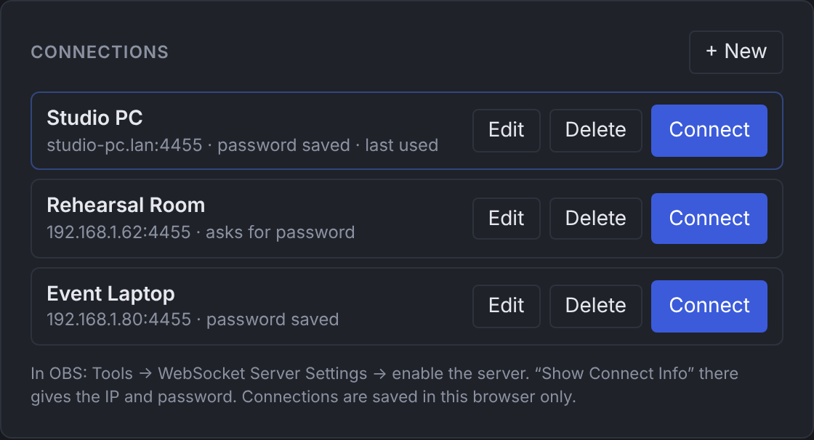
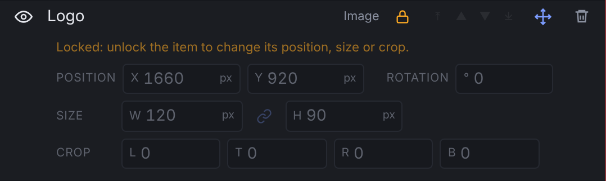

# Stagehand

**A web controller for OBS Studio.**
<br clear="left">

[](https://github.com/julesrodrigues11/stagehand-obs/actions/workflows/ci.yml)

A browser-based remote control for [OBS Studio](https://obsproject.com/), built on the
obs-websocket v5 protocol that ships with OBS 28 and later. Run it on any computer on the same
network as your OBS machine to switch scenes, show and hide sources, reorder and transform them,
add or delete them, and edit the settings of browser, media, image, slideshow and text sources
inline, without clicking into each source.

It is designed desktop-first, for dense screens where you want everything visible at once.

> **Unofficial.** This project is not affiliated with or endorsed by the OBS Project.
> "OBS" and "OBS Studio" are trademarks of the OBS Project.


<sub>Screenshots use invented demo content.</sub>

## What it is (and isn't) for

Stagehand is meant to **augment** OBS during a live session: the quick, frequent
changes you'd otherwise have to make by reaching over to the OBS machine and clicking through
property windows, such as switching scenes, showing or hiding sources, swapping a URL, file or
caption, nudging a position, or adding a source on the fly.

It is **not a replacement for OBS**. More specialist work is still done in OBS itself, including:

- **Audio**: there are currently no audio controls (volume, mute, monitoring, audio tracks,
  sync offset) for any source
- Filters and effects
- Starting/stopping streaming, recording or the virtual camera (Stagehand only *shows* whether
  they're running)
- Transitions, Studio Mode, profiles, scene collections and OBS settings
- Reordering or duplicating scenes
- Editing source types other than Browser, Media, Image, Image Slideshow and Text

---

## Contents

- [What it is (and isn't) for](#what-it-is-and-isnt-for)
- [Features](#features)
- [How it works](#how-it-works)
- [Where to run it](#where-to-run-it)
- [Requirements](#requirements)
- [Setting up OBS](#setting-up-obs)
- [Hosting on the OBS PC](#hosting-on-the-obs-pc)
  - [Hosting on macOS or Linux](#hosting-on-macos-or-linux)
- [Running from source](#running-from-source)
- [Connecting](#connecting)
- [Using the app](#using-the-app)
  - [OBS stats](#obs-stats)
  - [Program preview](#program-preview)
  - [Scene preview](#scene-preview)
  - [Scenes panel](#scenes-panel)
  - [Sources panel](#sources-panel)
  - [Editing fields](#editing-fields)
  - [Show mode](#show-mode)
- [What the app stores](#what-the-app-stores)
- [Security](#security)
- [Troubleshooting](#troubleshooting)
- [Limitations](#limitations)
- [Development](#development)
- [Testing](#testing)
- [Releasing](#releasing)
- [Licence](#licence)

---

## Features

**Scenes**
- Every scene listed in OBS order, with its sources, groups and nested scenes
- **Go live** button per scene (switches the Program scene)
- Show/hide any item with one click; hidden items are greyed out
- Reorder items: to top, up, down, to bottom (also inside groups)
- **Lock** items (the same lock as OBS's padlock) so their position, size and order can't be
  changed by accident
- Inline **transform editor**: position, rotation, size (or bounding box), crop, with aspect lock
- **Add sources** to a scene: create a new Browser, Media, Image, Image Slideshow or Text source,
  or add an existing source or scene
- **Create** new scenes and **rename** scenes
- **Delete** items, sources and scenes, with a confirmation step
- Collapsible, low-rate **preview** of the live scene, plus a second preview for any other scene
  (to check the next scene before it goes live)
- **Show mode**: protects the live scene and everything on air from accidental changes, while
  other scenes stay editable

**Sources**
- One editable table per source type, all visible at once:
  - **Browser**: URL or local file, width × height, refresh
  - **Media**: file or stream URL, loop, play/pause/restart/stop with live status
  - **Image**: file path
  - **Image Slideshow**: full file/folder list editor, seconds per slide, loop, previous/next
  - **Text**: text, font size, colour
- Show **all sources**, only the **live scene's**, or any **chosen scene's**
- Filter by source type and by text (matches names, URLs, paths and text content)
- **LIVE** badge on sources that are actually visible on air
- Raw settings view (`{ }`) for every source, including types without an editor

**General**
- **OBS stats** in the top bar: FPS, CPU, stream and recording time, with warnings for skipped
  or dropped frames and low disk space
- Saved connections (name, address, port, optional saved password), with **export and import**
  to share them as a file
- **Hosting package** for the OBS PC: a small web server with start / start-at-log-in scripts,
  so colleagues just open an address; new connections then point at the OBS PC automatically
- Version number in the top bar; releases with notes and a download on GitHub
- Live sync: changes made in OBS itself appear immediately
- Automatic reconnection if OBS restarts or the network drops
- Clear error messages naming the request, source and OBS error code

---

## How it works

The app is a static web page. Your browser connects **directly** to the WebSocket server that is
built into OBS. Nothing needs to be installed on the OBS machine, and there is no backend.

```
[Controller PC]                                  [OBS PC]
 browser ── loads the app (localhost or LAN)
    └──── ws://<obs-pc-ip>:4455 ─────────────►   OBS (built-in WebSocket server)
```

---

## Where to run it

The app has to be **served** by some computer, and then any browser on the network can use it.
That computer can be the OBS PC, your own PC, or another PC that's always on: the app works the
same way in each case, because the browser always talks to OBS directly.

| Setup | Best for | How |
|---|---|---|
| **Hosted on the OBS PC** (recommended) | Everyday use by you and colleagues | Download the release zip, start `start.bat` (or let it start at log-in). Everyone opens `http://<obs-pc>:8080`; nothing is installed on their computers, and new connections already point at the OBS PC. See [Hosting on the OBS PC](#hosting-on-the-obs-pc). |
| **From source on your own PC** | Development, or when only you use it | `npm install`, `npm run dev`, open `http://localhost:5173`. See [Running from source](#running-from-source). |
| **Hosted on another always-on PC** | When the OBS PC shouldn't run anything extra | Same package as the OBS PC. Set `"obsHost"` in `host-config.json` to the OBS PC's address so new connections point at it. |

---

## Requirements

| Where | What |
|---|---|
| OBS PC | OBS Studio **28 or later** (obs-websocket v5 is built in). OBS 30 or later is recommended: older versions don't report source setting changes live. |
| PC that serves the app | [Node.js](https://nodejs.org/) LTS (`node -v` to check). Running from source or running the tests needs **22.12 or later**. Computers that only *use* the app need nothing but a browser. |
| Browser | A current Chromium-based browser, Firefox or Safari |
| Network | Both machines on the same local network |

---

## Setting up OBS

1. In OBS, open **Tools → WebSocket Server Settings**.
2. Tick **Enable WebSocket server**.
3. Leave the port at **4455** (or note the one you choose).
4. Tick **Enable Authentication** and set a password.
5. Click **Show Connect Info** to see the OBS PC's IP address and password. You'll need both.
6. **Windows Firewall:** allow inbound **TCP 4455** on the OBS PC for your private network.
   Windows may prompt you the first time; otherwise add an inbound rule in
   *Windows Defender Firewall → Advanced settings → Inbound Rules*.

> Tip: give the OBS PC a fixed IP address (or a DHCP reservation on your router) so your saved
> connection keeps working.

---

## Hosting on the OBS PC

Each [release](https://github.com/julesrodrigues11/stagehand-obs/releases) has a zip,
`stagehand-obs-v<version>-windows.zip`, containing the built app and a small web server. The
steps below are for Windows; for a Mac or Linux PC, see
[Hosting on macOS or Linux](#hosting-on-macos-or-linux).

**First-time setup** (once, on the OBS PC):

1. Install [Node.js](https://nodejs.org/) LTS if it isn't already.
2. Download the zip from the latest release. Right-click it → **Properties** → tick **Unblock** →
   **OK** (avoids Windows security prompts), then extract the `stagehand-obs` folder
   somewhere permanent, e.g. `C:\Stagehand\`.
3. Right-click **`add-firewall-rule.bat`** → **Run as administrator**. This allows other PCs to
   reach the app (port 8080) and OBS's WebSocket server (port 4455) on private networks.
4. Double-click **`start.bat`**. Its window shows the addresses to use, for example:
   ```
   Stagehand v0.3.0 is running.
     On this PC:        http://localhost:8080
     From other PCs:    http://192.168.1.50:8080
   ```
   Keep the window open (minimise it) while the app is in use; closing it stops the app.
5. Optional: double-click **`install-autostart.bat`** so it starts, minimised, whenever you log
   in. **`remove-autostart.bat`** undoes this.

Colleagues open the "From other PCs" address and bookmark it. **+ New** connections already have
the OBS PC's address filled in, so they only enter the OBS WebSocket password.

**Settings** are in `host-config.json` in the same folder (restart `start.bat` after changing):

| Setting | Default | Meaning |
|---|---|---|
| `port` | `8080` | Port the app is served on. If you change it, run `add-firewall-rule.bat <port>` as administrator. |
| `obsHost` | `"same"` | Where OBS is, used to pre-fill new connections: `"same"` (this PC), an address such as `"192.168.1.70"` (OBS on another PC), or `null` (no suggestion). |
| `obsPort` | `4455` | OBS WebSocket port, used to pre-fill new connections. |

**Updating:** close the `start.bat` window, download the new release zip (unblock it as before),
replace the folder's contents (keep `host-config.json` if you changed it), and start it again.
Users just reload the page; their saved connections stay in their browsers (as long as the
address and port stay the same: browsers keep a separate list per address).

**Updating from OBS Web Controller** (the app's name up to v0.2): the folder is now called
`stagehand-obs`. After replacing it, run `install-autostart.bat` again if you use it, and
`add-firewall-rule.bat` as administrator; both remove the old-named shortcut and firewall rules.
Connections files exported under the old name still import.

The zip also contains `README-host.txt` with these steps, for the OBS PC itself.

### Hosting on macOS or Linux

The app works in any modern browser on any system, and OBS can run on any system too. Only the
helper scripts in the zip (`start.bat`, `install-autostart.bat`, `remove-autostart.bat`,
`add-firewall-rule.bat`) are **Windows-only**. The web server itself (`server.mjs`) runs anywhere
Node.js 22.12 or newer does. (It's tested on Linux; macOS should behave the same but hasn't been
tested yet.)

1. Install [Node.js](https://nodejs.org/) LTS, then download the same release zip and extract the
   `stagehand-obs` folder somewhere permanent. (There's nothing to unblock.)
2. Start the server from a terminal, and keep the terminal open while the app is in use (Ctrl+C
   stops it):
   ```
   cd path/to/stagehand-obs
   node server.mjs
   ```
   It prints the same addresses as on Windows. `host-config.json` works the same way, and
   `node server.mjs --port 9000` overrides the port for one run.
3. **Firewall:** allow incoming connections on port **8080** (Stagehand) and, on the PC running
   OBS, **4455** (OBS WebSocket).
   - **macOS:** if the firewall is on, click **Allow** when asked whether `node` may accept
     incoming connections. OBS may ask the same.
   - **Linux** with ufw: `sudo ufw allow 8080/tcp` (and `sudo ufw allow 4455/tcp` on the OBS PC).
4. **Starting at log-in (optional):**
   - **macOS:** create a file `start-stagehand.command` in the folder containing
     ```
     #!/bin/zsh
     cd "$(dirname "$0")"
     node server.mjs
     ```
     make it runnable with `chmod +x start-stagehand.command`, and add it under
     *System Settings → General → Login Items*. It opens a Terminal window at log-in.
   - **Linux:** a systemd service, e.g. `/etc/systemd/system/stagehand.service`:
     ```
     [Unit]
     Description=Stagehand web server
     After=network-online.target
     Wants=network-online.target

     [Service]
     ExecStart=/usr/bin/node /opt/stagehand-obs/server.mjs
     Restart=on-failure
     User=your-user-name

     [Install]
     WantedBy=multi-user.target
     ```
     Adjust the paths (`which node` shows Node's), then
     `sudo systemctl enable --now stagehand`.

**On a Mac running macOS 15 or newer**, the browser may ask for permission to find devices on
your local network the first time you connect to OBS. Allow it, or Stagehand can't reach OBS
(*System Settings → Privacy & Security → Local Network* if you missed the prompt).


To build the same package yourself from source: `npm run package` (creates
`release/stagehand-obs/`). To try the host server locally on a build: `npm run build`, then
`npm run serve` (serves `dist/` at `http://localhost:8080`).

---

## Running from source

Clone the repository, then on **your PC**:

```bash
npm install     # first time only
npm run dev     # starts the app at http://localhost:5173
```

Open <http://localhost:5173> in your browser.

### Other ways to run it

| Command | What it does |
|---|---|
| `npm run dev` | Development server on this machine only |
| `npm run host` | Development server that other machines on the LAN can open at `http://<this-pc-ip>:5173` |
| `npm run build` | Builds a static copy into `dist/` |
| `npm run preview` | Serves the built `dist/` folder locally to check it |
| `npm run lint` | Lints the source code |
| `npm run typecheck` | Checks the TypeScript types without building |
| `npm test` | Runs the automated tests once ([see Testing](#testing)) |
| `npm run test:watch` | Re-runs the tests whenever you save a file |
| `npm run package` | Builds and assembles the hosting package in `release/` |
| `npm run serve` | Serves the built `dist/` with the host server at `http://localhost:8080` |

`dist/` is a self-contained static site with relative paths, so any web server can host it.
The included host server adds the "same PC" connection default and update-friendly caching.
Serve it over **plain HTTP on your LAN** (see [Troubleshooting](#troubleshooting) for why HTTPS
pages can't reach OBS without extra setup).

---

## Connecting

The first screen is your list of **saved connections**.



- **+ New** opens a form: name, OBS PC address, port, password.
  - **Save password in this browser**: tick to connect with one click; untick to be asked for
    the password each time (recommended on shared computers).
  - The eye button shows or hides the password as you type.
  - **Save** stores it; **Save & connect** stores it and connects.
- **Connect** connects using that saved connection.
- **Edit** updates the address, port or password, for example if the OBS PC's IP changes.
- **Delete** removes it after a confirmation.

### Sharing connections (Export / Import)

Saved connections live in one browser. To copy them to another computer or give them to a
colleague, use **Export** and **Import** at the top of the connections screen.

- **Export** saves all your connections to a file
  (`stagehand-connections-<date>.json`). Passwords are **left out** unless you tick
  **Include saved passwords**; the file then holds them as plain text, so treat it like a
  password.
- **Import** reads such a file:
  - Connections you don't have yet are **added**. If the file has no password for one, it
    will ask for the password when you connect (use **Edit** to save it).
  - If a connection has the **same name** as one of yours (capitals and spaces ignored) but a
    different address, port or password, you're asked once: **Update them** (take the file's
    details; your saved password is kept if the file has none), **Keep mine**, or
    **Cancel import**.
  - Identical connections are left alone. A summary says what was added, updated or kept.
- **First run:** when there are no saved connections yet, the app opens on the
  **New connection** form, which also offers **Import file…**. Pick a connections file and the
  form closes, showing the imported connections ready to use. If the file can't be read, the
  reason is shown and the form stays open.

The file also has room for future settings (such as presets), so one file will carry them all.

When the app is [hosted on the OBS PC](#hosting-on-the-obs-pc), **+ New** starts with that
PC's address and OBS port filled in (fields you type in are never overwritten).

The status bar shows the app's version (e.g. *v0.1.0*), which connection you're on, the OBS
and obs-websocket versions, and a **Disconnect** button. If the connection drops, a banner appears and the app reconnects by
itself (after 1, 2, 5, then every 10 seconds). A wrong password is not retried.

---

## Using the app

The screen has two panels: **Scenes** on the left, **Sources** on the right.

### OBS stats

While connected, the top bar shows how OBS is doing, updated every 2 seconds:

```
30 fps   CPU 8%   ● STREAM 1:02:33   ● REC 42:10
```

| Shown | Meaning |
|---|---|
| **fps** | Frames per second OBS is actually rendering |
| **CPU** | OBS's CPU use. Left out if OBS doesn't report it (some systems don't) |
| **● STREAM** / **● REC** | Streaming / recording, with elapsed time (*REC (paused)* when paused). Only shown while running |
| **Disk** | Free space on the recording drive. Only shown when low: amber under 10 GB, red under 2 GB |
| **⚠** | A problem since the last update (below) |

Warnings turn **amber** when any frames were lost in the last 2 seconds, and **red** when more
than 5% were:

- **skipping frames while rendering**: the OBS PC can't keep up (the fps number changes colour);
- **encoder skipping frames**: the encoder is overloaded;
- **stream dropping frames**: the network can't keep up (the STREAM label changes colour).

Hover over the strip for details: render time per frame, memory, total skipped and dropped
frames, and free disk space. The numbers are the same as in OBS's own *Docks → Stats*. Stagehand
only reads them: streaming and recording are still started and stopped in OBS.
If something goes wrong with the strip itself, it hides and the rest of the app carries on.

> With the previews open, keep an eye on the fps and skipped frames: if they get worse, slow the
> previews down or collapse them.

### Program preview

At the top of the Scenes panel, **Program: \<scene\>** shows a snapshot of what is live.

- Click the header to expand or collapse it. The app remembers your choice.
- The dropdown sets how often it refreshes: every 0.5, 1, 2 or 5 seconds.
- It is a series of still images, not video. Snapshots are only taken while the preview is
  expanded and the browser tab is visible, so collapsing it puts no load on OBS.

### Scene preview

Under the live preview, **Preview: \<scene\>** shows any other scene **without putting it on
air**, so you can check the scene you're preparing while still watching what's live.

- Pick the scene from its dropdown, or click the **monitor icon** in a scene's header.
- It refreshes every 1, 2 or 5 seconds (2 by default, slower than the live preview, to spare OBS).
  Like the live preview, it only takes snapshots while expanded and the tab is visible.
- **Go live** on the panel puts the previewed scene on air (asking first in
  [show mode](#show-mode)). If the previewed scene is the live one, it shows **LIVE** instead.
- It keeps following a scene you rename in Stagehand.

> Sources that only run while on air may look blank or out of date here: browser sources with
> *Shutdown source when not visible* ticked, and media set to restart when it becomes active.
> Images, text, colours and positions always show correctly.

With both previews open, OBS makes two sets of snapshots. If OBS's stats show lag during a show,
slow one of them down or collapse the scene preview.

### Scenes panel

Each scene is a collapsible box. The header shows:

| Control | What it does |
|---|---|
| ▸ name, count | Collapse or expand the scene (remembered). Double-click the name to rename it |
| pencil | Rename the scene |
| **+** | Add a source to this scene ([see below](#adding-sources)) |
| monitor icon | Show this scene in the [scene preview](#scene-preview), without putting it on air |
| list icon | Show only this scene's sources in the Sources panel |
| bin | Delete the scene (with confirmation) |
| **Go live** / **LIVE** | Switch the live scene to this one / marks the scene that is live |

Use **Expand** / **Collapse** at the top to open or close all scenes, and the filter box to find
scenes and sources by name or type (e.g. `browser`). Escape clears the filter.

#### Creating and renaming scenes

- **+ Scene** (top of the panel) opens a small form with a suggested name such as *Scene 2*.
  Change it if you like and press **Create** (or Enter). The new, empty scene appears in the
  list; add sources to it with its **+** button. Escape or **Cancel** closes the form.
- **Rename** with the pencil on a scene header, or by double-clicking the scene's name. The name
  becomes a field: **Enter** or clicking away renames, **Escape** cancels.

Names must be unique across all scenes and sources: a name that's already used is flagged and
can't be applied (clicking away with such a name cancels the rename). Renaming the live scene is
fine; it stays live. The scene's collapsed state, and the Sources panel if it's showing that
scene, follow the new name. Scenes nested inside other scenes are renamed there too.

#### Items

Each item row shows, from left to right:

| Control | What it does |
|---|---|
| eye | Show or hide the item in this scene (applies immediately) |
| name, type | Source name and type label (Browser, Media, Text, Group, Scene…) |
| padlock | Lock or unlock the item ([see below](#locking-items)). Amber and closed when locked |
| ⤒ ▲ ▼ ⤓ | Move to top / up / down / to bottom. Faint until you hover the row |
| arrows icon | Open the transform editor |
| bin | Remove or delete ([see below](#removing-and-deleting)) |

The top of the list is drawn above everything below it, as in OBS's Sources dock. Groups show
their contents indented underneath.

> Covering a source with another one does not hide it: it still counts as on air and keeps
> running (a covered browser source still plays audio). Use the eye to turn it off.

#### Transform editor

Opens under the item; several can be open at once. Fields:


- **Position** X / Y (pixels)
- **Rotation** (degrees)
- **Size** W / H (pixels). If the item uses a bounding box in OBS, this edits the **Bounds** box
  instead and shows its type. The link button locks the aspect ratio (on by default).
- **Crop** left / top / right / bottom (pixels)

Open editors update live if you move the item in OBS.

#### Locking items

The padlock on each item is **OBS's own lock** (the padlock in OBS's Sources dock): locking an
item in Stagehand locks it in OBS, and the other way round. Use it for things that should never
move, such as a logo, a camera frame or a background.



While an item is locked:

- its **transform editor** shows the values but can't change them;
- its **order buttons** are disabled (its neighbours can still move around it);
- it can still be **shown or hidden**, its source's settings can still be edited, and it can
  still be removed or deleted.

Because the lock is stored in OBS's scene collection, it applies to everyone: every Stagehand
user, and OBS itself (where a locked item can't be dragged or resized in the preview). OBS's own
lock doesn't block reordering; Stagehand does, so a locked item can't be sent behind something
by accident.

#### Adding sources

Click **+** on a scene header.


- **New source**: choose the type, accept or change the suggested name (names must be unique
  across all sources and scenes; clashes are flagged), and fill in the main setting:
  - Browser: URL, plus size (defaults to your canvas size so it fills the screen)
  - Media: file path, or tick *Network stream / URL* for a stream address
  - Image: file path
  - Image Slideshow: an image or a folder path (add more later with *Edit files*)
  - Text: the text
- **Existing source**: search and click any source, or another scene to nest it. Sources
  already in the scene are marked.
- **Start hidden** adds the item hidden so you can set it up before showing it. It is ticked
  automatically when you add to the live scene.

New items appear at the top of the scene at OBS's default position. Use the transform editor to
place them.

#### Removing and deleting

Every delete needs a second click on a confirmation bar (Escape cancels), because nothing can be
undone over obs-websocket.

- **Item bin (Scenes panel)**: *Remove from \<scene\>* takes it out of this scene only. If the
  source is used in other scenes too, *Delete from all N* deletes the source everywhere. Groups
  and nested scenes can only be removed from the scene.
- **Scene bin**: deletes the scene. Disabled for the live scene (switch away first) and for the
  last remaining scene. Warns if the scene is nested inside others.

### Sources panel

#### Choosing what to show

- **Scope dropdown** (next to the title):
  - **All sources**
  - **Live scene**: follows whatever is live (the default)
  - **A specific scene**: useful for preparing the next scene without touching what's on air

  A scene's sources include those inside its groups and nested scenes. Sources that are in the
  scene but hidden are greyed out with a *hidden here* tag.
- **Type buttons**: click to show or hide a type; **Ctrl+click** shows only that type; **All**
  resets. Counts follow the scope.
- **Filter box**: matches names, URLs, file paths, slideshow paths and text content.

A red edge and **LIVE** badge mark sources that are actually visible on air right now.

#### Tables


| Table | Columns |
|---|---|
| Browser | URL (or local file path), *Local file* toggle, W × H, **Refresh** (reloads and clears the page cache) |
| Media | File path (or URL), *Local file* and *Loop* toggles, ◀◀ ▶/❚❚ ↺ ■ controls and status |
| Image | File path |
| Image Slideshow | Summary of items (click it to edit), seconds per slide, *Loop*, previous / play-pause / next / restart / stop |
| Text | Text (multi-line), font size, colour |
| Other | Any other source type: name and type, with raw settings only |

Every row also has:
- `{ }`: show every setting OBS stores for the source (read-only), useful for checking values
- bin: delete the source from every scene, after a confirmation that lists where it's used

**Slideshow file list** (*Edit files*): edit each path, include or exclude it with the eye,
reorder with ↑ ↓, remove with ✕, and add new images or folders in the last row. Removing an
entry only takes it out of the list; it never deletes files.

### Editing fields

| Action | Result |
|---|---|
| Type in a field | Field turns **amber**: not sent yet |
| **Enter** | Apply |
| Click or Tab away | Apply |
| **Escape** | Cancel and restore the current value |
| Text field: **Enter** | New line |
| Text field: **Ctrl+Enter** or click away | Apply |
| Checkboxes, eye buttons, Go live, media buttons | Apply immediately |
| Colour swatch | Applies when you close the colour picker |

File paths are on the **OBS PC**, not the computer you're typing on. Surrounding quotes are
removed automatically, so you can paste straight from Windows Explorer's *Copy as path*.

Changes to a source marked **LIVE** appear on stream immediately.

### Show mode

Turn on **Show mode** (top bar, next to *Connected*) before a show. While it's on, Stagehand
protects what's on air from accidental clicks, but lets you keep preparing the next scene.

| | Protected (greyed out) | Still allowed |
|---|---|---|
| **The live scene**, and groups and scenes nested in it | Show/hide, order, transform (read-only), add, remove, rename, delete | Locking items, viewing transforms, collapsing |
| **Sources visible on air** (marked **LIVE**), wherever you edit them | Settings, Refresh, media and slideshow controls, delete | `{ }` (viewing settings) |
| **Other scenes and sources** | Nothing | Everything |
| **Go live** (on a scene or the scene preview) | | Asks *"Switch the live scene from A to B?"* first |

- Protection **follows the live scene**: after Go live, the new live scene is protected and the
  old one becomes editable. This also happens when the scene is switched in OBS or from another
  device.
- A source used in several scenes is protected everywhere while it's on air, because changing it
  in any scene changes it on stream.
- Show mode is a setting of **this browser**: it's remembered after a reload, but it isn't
  shared. Someone else's Stagehand, OBS itself and other tools aren't affected.
- To change something that's on air, turn show mode off, make the change, and turn it back on.

---

## What the app stores

Everything is kept in **this browser's local storage** on the controller PC; nothing is sent
anywhere except to OBS.

| Item | Notes |
|---|---|
| Saved connections | Name, address, port; password only if you ticked *Save password* |
| Interface choices | Collapsed scenes, previews (open, rate, chosen scene), aspect lock, source scope and type filter, show mode |

Saved connections are per browser; use **Export** / **Import** to move them to another
computer. Clearing the browser's site data removes everything.

---

## Security

- The obs-websocket password gives **full control of OBS**, including file paths on the OBS PC.
  Always set one.
- Saved passwords are stored **unencrypted** in browser storage. Don't save them on shared
  computers.
- An export made with **Include saved passwords** contains them as plain text. Share or store
  such files only where you'd write the password down.
- The connection to OBS is unencrypted (`ws://`). Use the app on a trusted local network only.
- **Never forward port 4455 to the internet.** For remote access, use a VPN such as Tailscale or
  WireGuard instead.

Found a security problem? Please report it privately, as described in [SECURITY.md](SECURITY.md).

---

## Troubleshooting

| Problem | Things to check |
|---|---|
| *Could not reach OBS* | Correct IP and port? WebSocket server enabled in OBS? Windows Firewall allowing inbound TCP 4455 on the OBS PC? Both machines on the same network? On macOS 15+, has the browser been allowed *Local Network* access (System Settings → Privacy & Security)? |
| *Wrong password* | Re-check in OBS via *Show Connect Info*; use the eye button to see what you typed |
| Connection works locally but not from a hosted HTTPS page | Browsers block `ws://` from `https://` pages, and Chromium browsers also ask permission before a public site can reach your local network. Serve the app over plain HTTP on your LAN, or put a TLS proxy in front of obs-websocket and use `wss://`. |
| A source shows *Couldn't read settings* | The message names the request and OBS's error code. Details are also in the browser console (F12). |
| Some fields look blank | OBS only reports values you've changed; defaults come from a separate request that some source types refuse. Open `{ }` to see what OBS actually stores. |
| Changes made in OBS don't appear | Your OBS's obs-websocket is older than 5.4 (a banner says so). Update OBS, or reconnect to refresh. |
| A source type isn't in the tables | It appears in the **Other** table with its type ID; it has no editor yet. |
| Hosting: *Node.js isn't installed* | Install Node.js LTS, then close and reopen the `start.bat` window. |
| Hosting: *port 8080 is already in use* | It's probably already running (check the taskbar), or another program uses the port: change `port` in `host-config.json`. |
| Hosting: other PCs can't open the address | Run `add-firewall-rule.bat` as administrator, and make sure Windows treats the network as **Private** (Settings → Network & internet). |
| Colleagues see an old version after an update | Reload the page (Ctrl+F5 if needed). The host server tells browsers to re-check the page, so this should be rare. |

---

## Limitations

- No audio controls, filters, stream/record controls or OBS settings: use OBS itself for these
  (the top bar shows stream and recording status, read-only)
  (see [What it is (and isn't) for](#what-it-is-and-isnt-for)).
- Only one operator at a time is assumed. Two people editing the same field: last change wins.
- It can't browse files on the OBS PC (obs-websocket has no file access), so paths are typed or
  pasted. It also can't list the images inside a slideshow folder.
- Sources and scenes are tracked by name. A rename at the exact moment of an edit makes that
  edit fail with an error rather than apply to the wrong source.
- No undo: deletions are permanent.
- Studio Mode (Preview/Program) isn't supported; *Go live* switches Program directly.
- Scenes can be created, renamed and deleted, but not reordered or duplicated (obs-websocket has
  no request for either). New scenes appear where OBS puts them.
- Editors exist for Browser, Media, Image, Image Slideshow and Text sources. Other types can be
  viewed (raw settings), added as existing sources and deleted, but not edited.
- Desktop-first layout; phones are not a target yet. Below roughly 1,200 px of window width,
  the right-hand columns of the Sources tables and the transform crop fields can be pushed out
  of view.

---

## Development

**Stack:** [Vite](https://vite.dev/), [React](https://react.dev/), TypeScript,
[obs-websocket-js](https://github.com/obs-websocket-community-projects/obs-websocket-js),
[Zustand](https://github.com/pmndrs/zustand).

```
src/
  obs/        client, error helpers, kind labels, transform maths, value helpers (paths, colours)
  store/      connection, profiles (saved connections), scenes, inputs (source settings),
              live (on-air calculations), names (unique names), ui (source scope),
              settingsFile (export/import file format)
  lib/        storage.ts (safe browser-storage helpers, list of stored keys), download.ts
  components/ shared UI: fields, number field, confirm bar, icons, connect screen (with
              export/import), status bar
  features/
    scenes/   ScenesPanel → SceneSection (one scene) → SceneHeader + ItemRow (one item) →
              OrderButtons; plus preview, transform editor, add-source, new-scene and rename
              forms, the filter rules (rows.ts) and collapsed state (useCollapsed.ts)
    sources/  Sources panel, per-type rows, slideshow file editor, raw/other rows
tests/
  mock/       a fake OBS (obs-websocket server) with demo scenes and sources
  unit/       tests for pure logic: maths, conversions, on-air rules
  app/        tests that drive the real interface against the fake OBS
  helpers.tsx render/connect helpers and "find this on screen" functions
host/         the hosting package: server.mjs (web server, Node built-ins only), start.bat,
              install/remove-autostart.bat, add-firewall-rule.bat, host-config.json,
              README-host.txt
scripts/      package.mjs (assembles the hosting package), changelog.mjs (release notes)
docs/
  requirements.md          decisions and feature notes
  manual-test-checklist.md things to check by hand against a real OBS
CHANGELOG.md               what changed in each version
.github/workflows/
  ci.yml                   the checks GitHub runs on every push
  release.yml              builds and publishes a release when a version tag is pushed
```

Key ideas:
- A **single** obs-websocket connection, owned by `store/connection.ts`. Other stores react to
  connection state and subscribe to OBS events, so the UI stays in sync with changes made
  anywhere.
- **Settings belong to sources** (edited in the Sources panel); **visibility, order and
  transform belong to scene items** (edited in the Scenes panel). Changing a source's URL
  changes it in every scene that uses it.
- `GetInputSettings` omits default values, so the app merges them over `GetInputDefaultSettings`.
- Settings updates use `overlay: true`, which merges only the top level: nested objects (`font`)
  and lists (slideshow `files`) are always sent whole.

See `src/README.md` for the folder layout and `docs/requirements.md` for design decisions.

Want to report a bug or contribute? See [CONTRIBUTING.md](CONTRIBUTING.md).

---

## Testing

### Running the tests

```bash
npm test             # run everything once (about 15 seconds)
npm run test:watch   # keep running and re-test whenever you save a file
npx vitest run tests/app/sources.test.tsx   # just one file
npx vitest run -t "Escape"                  # just tests whose name contains "Escape"
```

The tests need Node.js 22.12 or later (the minimum for Vitest).

Each test prints a ✓ or ✗ with its name, then a summary. A failure shows which test failed, what
it expected, what actually happened, and the line in the test file.

### What the tests cover

The tests don't need OBS. They start a **fake OBS** (`tests/mock/mockObs.ts`): a small
obs-websocket server that checks the password like OBS, holds demo scenes and sources (the same
show as the screenshots), changes its state when the app sends requests, and sends the same
events OBS sends. It also records every request, so tests can check exactly what the app sent,
and it can fail requests or drop connections on purpose.

| Folder / file | What's tested |
|---|---|
| `tests/unit/` | Pure logic: size↔scale maths, colour and path conversion, on-air rules, choosing source types, unique names, error messages, scene filter rules, safe storage, export/import file handling |
| `tests/app/connection.test.tsx` | Connecting, wrong password, unreachable OBS, automatic reconnection, old-OBS warning, saved connections |
| `tests/app/scenes.test.tsx` | Scene/item order, visibility, Go live, ordering, transform editor, filter, preview |
| `tests/app/sources.test.tsx` | Editing every source type, apply/cancel rules, slideshow list, media controls, live sync, partial load failures, scope and filters |
| `tests/app/manage.test.tsx` | Adding, removing and deleting sources; creating, renaming and deleting scenes |
| `tests/app/transfer.test.tsx` | Exporting (with/without passwords) and importing connections, including the update-or-keep question and bad files |
| `tests/app/hosting.test.tsx` | Version in the top bar; pre-filled connections when hosted (same PC / other PC / not hosted), never overwriting typed values |
| `tests/unit/server.test.ts`, `changelog.test.ts` | The host server (files, caching, `host.json`, refusing paths outside the app, settings) and the changelog/release-notes script |

App tests use [Testing Library](https://testing-library.com/) to click and type like a person
would, in a simulated browser ([jsdom](https://github.com/jsdom/jsdom)), run by
[Vitest](https://vitest.dev/).

### Continuous integration

Every push to GitHub runs `.github/workflows/ci.yml`: install, type-check, lint, test, build. The
badge at the top of this README shows the latest result, and each commit gets a ✓ or ✗ on
GitHub. To see why a run failed, open the **Actions** tab, click the run, and expand the red step.

### What the tests can't check

The fake OBS behaves like the real one as far as the app is concerned, but it isn't OBS. Things
that depend on OBS itself (the real defaults for each source type, how sources actually render,
media playback) are covered by a short manual checklist:
[docs/manual-test-checklist.md](docs/manual-test-checklist.md). Run through it after upgrading
OBS or making larger changes.

### Adding a test

Copy a nearby test and adapt it. A typical app test:

```tsx
test('the eye hides an item, and OBS receives the change', async () => {
  const { obs, user } = await renderConnected()               // app + fake OBS, connected
  await user.click(buttonTitled(itemRow('Main', 'Chat Overlay'), /click to hide/))
  expect(await waitForRequest(obs, 'SetSceneItemEnabled'))    // what OBS received
    .toMatchObject({ sceneName: 'Main', sceneItemEnabled: false })
})
```

---

## Releasing

Versions follow [semantic versioning](https://semver.org/), **MAJOR.MINOR.PATCH**:

| Part | Goes up for | Example |
|---|---|---|
| PATCH | Bug fixes only | 0.2.0 → 0.2.1 |
| MINOR | New features that don't break existing use | 0.2.1 → 0.3.0 |
| MAJOR | Changes that break existing use (e.g. old export files no longer readable) | 1.4.0 → 2.0.0 |

While the version starts with **0**, the app is usable but still settling; 1.0.0 marks it as
stable. The version lives only in `package.json`; the app shows it in the top bar and the host
server prints it on start.

**As you go:** add each change to the **Unreleased** section of [CHANGELOG.md](CHANGELOG.md),
under *Added*, *Changed* or *Fixed*.

**To release** (with everything committed and pushed):

```bash
npm version minor          # or: npm version patch / npm version major
git push --follow-tags
```

`npm version` updates `package.json`, moves the Unreleased notes in `CHANGELOG.md` under the new
version and today's date, commits ("Release v0.2.0") and tags the commit (`v0.2.0`). It stops
with a message if the Unreleased section is empty.

Pushing the tag starts the **Release** workflow (`.github/workflows/release.yml`) on GitHub. It
checks the tag matches `package.json`, runs the type-check, lint and tests, builds the hosting
package, zips it, and publishes a **Release** on the repository's
[Releases page](https://github.com/julesrodrigues11/stagehand-obs/releases) with the
changelog notes and the zip attached. Watch it on the **Actions** tab; it takes a few minutes.

If the release workflow fails, nothing is published. Fix the problem, then either delete the tag
(`git tag -d v0.2.0` and `git push --delete origin v0.2.0`) and release again, or release the
fix as the next patch version.

## Licence

Stagehand is released under the [MIT Licence](LICENSE): you're free to use, copy, change and
share it, including commercially, as long as the copyright notice and licence text stay with
it. It comes with no warranty. The hosting zip includes the licence as `LICENSE.txt`.
