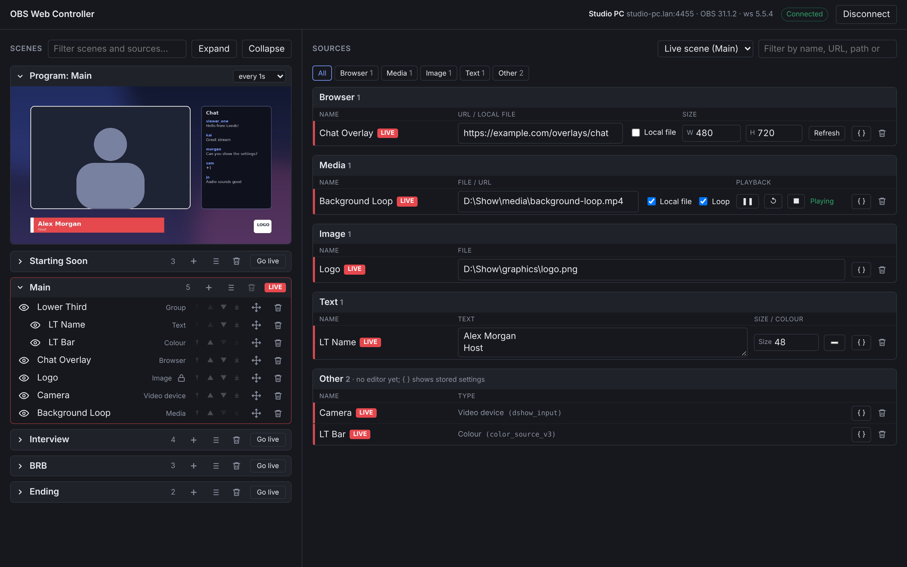
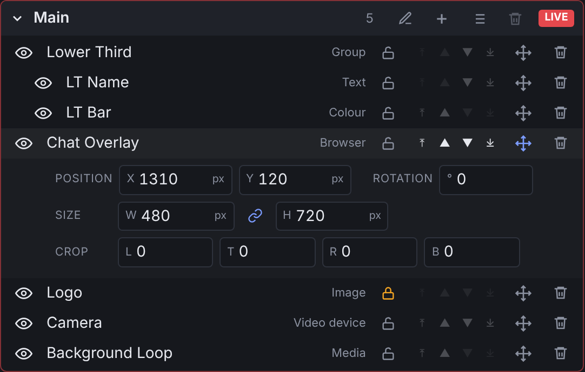
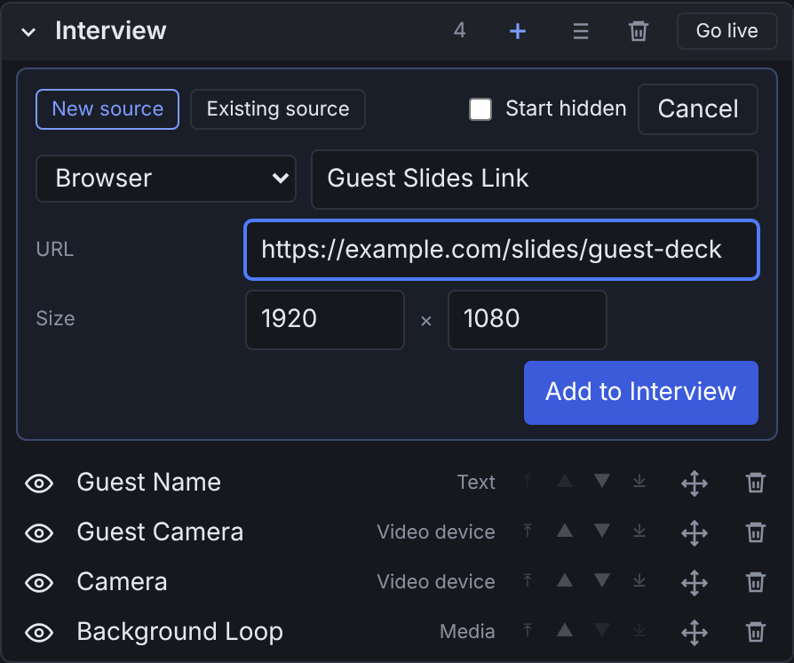
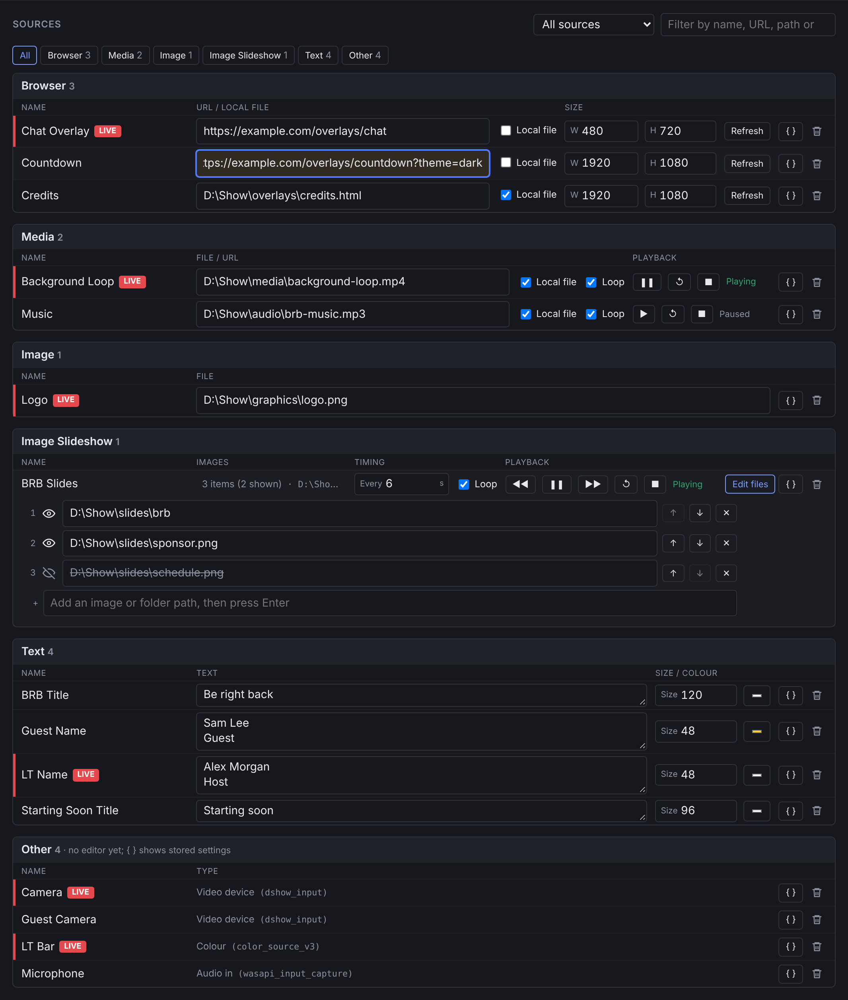

# OBS Web Controller

[](https://github.com/julesrodrigues11/OBSWebController/actions/workflows/ci.yml)

A browser-based remote control for [OBS Studio](https://obsproject.com/), built on the
obs-websocket v5 protocol that ships with OBS 28 and later. Run it on any computer on the same
network as your OBS machine to switch scenes, show and hide sources, reorder and transform them,
add or delete them, and edit the settings of browser, media, image, slideshow and text sources
inline, without clicking into each source.

It is designed desktop-first, for dense screens where you want everything visible at once.

> **Unofficial.** This project is not affiliated with or endorsed by the OBS Project.
> "OBS" and "OBS Studio" are trademarks of the OBS Project.



<sub>Screenshots use invented demo content.</sub>

## What it is (and isn't) for

OBS Web Controller is meant to **augment** OBS during a live session: the quick, frequent
changes you'd otherwise have to make by reaching over to the OBS machine and clicking through
property windows, such as switching scenes, showing or hiding sources, swapping a URL, file or
caption, nudging a position, or adding a source on the fly.

It is **not a replacement for OBS**. More specialist work is still done in OBS itself, including:

- **Audio**: there are currently no audio controls (volume, mute, monitoring, audio tracks,
  sync offset) for any source
- Filters and effects
- Starting/stopping streaming, recording or the virtual camera
- Transitions, Studio Mode, profiles, scene collections and OBS settings
- Reordering or duplicating scenes
- Editing source types other than Browser, Media, Image, Image Slideshow and Text

---

## Contents

- [What it is (and isn't) for](#what-it-is-and-isnt-for)
- [Features](#features)
- [How it works](#how-it-works)
- [Requirements](#requirements)
- [Setting up OBS](#setting-up-obs)
- [Installing and running](#installing-and-running)
- [Connecting](#connecting)
- [Using the app](#using-the-app)
  - [Program preview](#program-preview)
  - [Scenes panel](#scenes-panel)
  - [Sources panel](#sources-panel)
  - [Editing fields](#editing-fields)
- [What the app stores](#what-the-app-stores)
- [Security](#security)
- [Troubleshooting](#troubleshooting)
- [Limitations](#limitations)
- [Development](#development)
- [Testing](#testing)

---

## Features

**Scenes**
- Every scene listed in OBS order, with its sources, groups and nested scenes
- **Go live** button per scene (switches the Program scene)
- Show/hide any item with one click; hidden items are greyed out
- Reorder items: to top, up, down, to bottom (also inside groups)
- Inline **transform editor**: position, rotation, size (or bounding box), crop, with aspect lock
- **Add sources** to a scene: create a new Browser, Media, Image, Image Slideshow or Text source,
  or add an existing source or scene
- **Create** new scenes and **rename** scenes
- **Delete** items, sources and scenes, with a confirmation step
- Collapsible, low-rate **preview** of the live scene

**Sources**
- One editable table per source type, all visible at once:
  - **Browser**: URL or local file, width × height, refresh
  - **Media**: file or stream URL, loop, play/pause/restart/stop with live status
  - **Image**: file path
  - **Image Slideshow**: full file/folder list editor, seconds per slide, loop, previous/next
  - **Text**: text, font size, colour
- Show **all sources**, only the **live scene's**, or any **chosen scene's**
- Filter by source type and by text (matches names, URLs, paths and text content)
- **LIVE** badge on sources that are actually visible on air
- Raw settings view (`{ }`) for every source, including types without an editor

**General**
- Saved connections (name, address, port, optional saved password)
- Live sync: changes made in OBS itself appear immediately
- Automatic reconnection if OBS restarts or the network drops
- Clear error messages naming the request, source and OBS error code

---

## How it works

The app is a static web page. Your browser connects **directly** to the WebSocket server that is
built into OBS. Nothing needs to be installed on the OBS machine, and there is no backend.

```
[Controller PC]                                  [OBS PC]
 browser ── loads the app (localhost or LAN)
    └──── ws://<obs-pc-ip>:4455 ─────────────►   OBS (built-in WebSocket server)
```

---

## Requirements

| Where | What |
|---|---|
| OBS PC | OBS Studio **28 or later** (obs-websocket v5 is built in). OBS 30 or later is recommended: older versions don't report source setting changes live. |
| Controller PC | [Node.js](https://nodejs.org/) **22.12 or later** (`node -v` to check). The current LTS (22 or 24) is recommended. |
| Browser | A current Chromium-based browser, Firefox or Safari |
| Network | Both machines on the same local network |

---

## Setting up OBS

1. In OBS, open **Tools → WebSocket Server Settings**.
2. Tick **Enable WebSocket server**.
3. Leave the port at **4455** (or note the one you choose).
4. Tick **Enable Authentication** and set a password.
5. Click **Show Connect Info** to see the OBS PC's IP address and password. You'll need both.
6. **Windows Firewall:** allow inbound **TCP 4455** on the OBS PC for your private network.
   Windows may prompt you the first time; otherwise add an inbound rule in
   *Windows Defender Firewall → Advanced settings → Inbound Rules*.

> Tip: give the OBS PC a fixed IP address (or a DHCP reservation on your router) so your saved
> connection keeps working.

---

## Installing and running

Clone the repository, then on the **controller PC**:

```bash
npm install     # first time only
npm run dev     # starts the app at http://localhost:5173
```

Open <http://localhost:5173> in your browser.

### Other ways to run it

| Command | What it does |
|---|---|
| `npm run dev` | Development server on this machine only |
| `npm run host` | Development server that other machines on the LAN can open at `http://<this-pc-ip>:5173` |
| `npm run build` | Builds a static copy into `dist/` |
| `npm run preview` | Serves the built `dist/` folder locally to check it |
| `npm run lint` | Lints the source code |
| `npm run typecheck` | Checks the TypeScript types without building |
| `npm test` | Runs the automated tests once ([see Testing](#testing)) |
| `npm run test:watch` | Re-runs the tests whenever you save a file |

### Hosting a built copy

`npm run build` produces a self-contained static site in `dist/` that uses relative paths, so it
can be served from any folder or web server, including from the OBS PC itself. Colleagues then
only need the URL and the OBS password. Any static file server works, for example:

```bash
npx serve dist
```

Serve it over **plain HTTP on your LAN** (see [Troubleshooting](#troubleshooting) for why HTTPS
pages can't reach OBS without extra setup).

---

## Connecting

The first screen is your list of **saved connections**.


- **+ New** opens a form: name, OBS PC address, port, password.
  - **Save password in this browser**: tick to connect with one click; untick to be asked for
    the password each time (recommended on shared computers).
  - The eye button shows or hides the password as you type.
  - **Save** stores it; **Save & connect** stores it and connects.
- **Connect** connects using that saved connection.
- **Edit** updates the address, port or password, for example if the OBS PC's IP changes.
- **Delete** removes it after a confirmation.

The status bar shows which connection you're on, the OBS and obs-websocket versions, and a
**Disconnect** button. If the connection drops, a banner appears and the app reconnects by
itself (after 1, 2, 5, then every 10 seconds). A wrong password is not retried.

---

## Using the app

The screen has two panels: **Scenes** on the left, **Sources** on the right.

### Program preview

At the top of the Scenes panel, **Program: \<scene\>** shows a snapshot of what is live.

- Click the header to expand or collapse it. The app remembers your choice.
- The dropdown sets how often it refreshes: every 0.5, 1, 2 or 5 seconds.
- It is a series of still images, not video. Snapshots are only taken while the preview is
  expanded and the browser tab is visible, so collapsing it puts no load on OBS.

### Scenes panel

Each scene is a collapsible box. The header shows:

| Control | What it does |
|---|---|
| ▸ name, count | Collapse or expand the scene (remembered). Double-click the name to rename it |
| pencil | Rename the scene |
| **+** | Add a source to this scene ([see below](#adding-sources)) |
| list icon | Show only this scene's sources in the Sources panel |
| bin | Delete the scene (with confirmation) |
| **Go live** / **LIVE** | Switch the live scene to this one / marks the scene that is live |

Use **Expand** / **Collapse** at the top to open or close all scenes, and the filter box to find
scenes and sources by name or type (e.g. `browser`). Escape clears the filter.

#### Creating and renaming scenes

- **+ Scene** (top of the panel) opens a small form with a suggested name such as *Scene 2*.
  Change it if you like and press **Create** (or Enter). The new, empty scene appears in the
  list; add sources to it with its **+** button. Escape or **Cancel** closes the form.
- **Rename** with the pencil on a scene header, or by double-clicking the scene's name. The name
  becomes a field: **Enter** or clicking away renames, **Escape** cancels.

Names must be unique across all scenes and sources: a name that's already used is flagged and
can't be applied (clicking away with such a name cancels the rename). Renaming the live scene is
fine; it stays live. The scene's collapsed state, and the Sources panel if it's showing that
scene, follow the new name. Scenes nested inside other scenes are renamed there too.

#### Items

Each item row shows, from left to right:

| Control | What it does |
|---|---|
| eye | Show or hide the item in this scene (applies immediately) |
| name, type | Source name and type label (Browser, Media, Text, Group, Scene…) |
| lock icon | Shown if the item is locked in OBS (read-only here) |
| ⤒ ▲ ▼ ⤓ | Move to top / up / down / to bottom. Faint until you hover the row |
| arrows icon | Open the transform editor |
| bin | Remove or delete ([see below](#removing-and-deleting)) |

The top of the list is drawn above everything below it, as in OBS's Sources dock. Groups show
their contents indented underneath.

> Covering a source with another one does not hide it: it still counts as on air and keeps
> running (a covered browser source still plays audio). Use the eye to turn it off.

#### Transform editor

Opens under the item; several can be open at once. Fields:



- **Position** X / Y (pixels)
- **Rotation** (degrees)
- **Size** W / H (pixels). If the item uses a bounding box in OBS, this edits the **Bounds** box
  instead and shows its type. The link button locks the aspect ratio (on by default).
- **Crop** left / top / right / bottom (pixels)

Open editors update live if you move the item in OBS.

#### Adding sources

Click **+** on a scene header.



- **New source**: choose the type, accept or change the suggested name (names must be unique
  across all sources and scenes; clashes are flagged), and fill in the main setting:
  - Browser: URL, plus size (defaults to your canvas size so it fills the screen)
  - Media: file path, or tick *Network stream / URL* for a stream address
  - Image: file path
  - Image Slideshow: an image or a folder path (add more later with *Edit files*)
  - Text: the text
- **Existing source**: search and click any source, or another scene to nest it. Sources
  already in the scene are marked.
- **Start hidden** adds the item hidden so you can set it up before showing it. It is ticked
  automatically when you add to the live scene.

New items appear at the top of the scene at OBS's default position. Use the transform editor to
place them.

#### Removing and deleting

Every delete needs a second click on a confirmation bar (Escape cancels), because nothing can be
undone over obs-websocket.

- **Item bin (Scenes panel)**: *Remove from \<scene\>* takes it out of this scene only. If the
  source is used in other scenes too, *Delete from all N* deletes the source everywhere. Groups
  and nested scenes can only be removed from the scene.
- **Scene bin**: deletes the scene. Disabled for the live scene (switch away first) and for the
  last remaining scene. Warns if the scene is nested inside others.

### Sources panel

#### Choosing what to show

- **Scope dropdown** (next to the title):
  - **All sources**
  - **Live scene**: follows whatever is live (the default)
  - **A specific scene**: useful for preparing the next scene without touching what's on air

  A scene's sources include those inside its groups and nested scenes. Sources that are in the
  scene but hidden are greyed out with a *hidden here* tag.
- **Type buttons**: click to show or hide a type; **Ctrl+click** shows only that type; **All**
  resets. Counts follow the scope.
- **Filter box**: matches names, URLs, file paths, slideshow paths and text content.

A red edge and **LIVE** badge mark sources that are actually visible on air right now.

#### Tables



| Table | Columns |
|---|---|
| Browser | URL (or local file path), *Local file* toggle, W × H, **Refresh** (reloads and clears the page cache) |
| Media | File path (or URL), *Local file* and *Loop* toggles, ◀◀ ▶/❚❚ ↺ ■ controls and status |
| Image | File path |
| Image Slideshow | Summary of items (click it to edit), seconds per slide, *Loop*, previous / play-pause / next / restart / stop |
| Text | Text (multi-line), font size, colour |
| Other | Any other source type: name and type, with raw settings only |

Every row also has:
- `{ }`: show every setting OBS stores for the source (read-only), useful for checking values
- bin: delete the source from every scene, after a confirmation that lists where it's used

**Slideshow file list** (*Edit files*): edit each path, include or exclude it with the eye,
reorder with ↑ ↓, remove with ✕, and add new images or folders in the last row. Removing an
entry only takes it out of the list; it never deletes files.

### Editing fields

| Action | Result |
|---|---|
| Type in a field | Field turns **amber**: not sent yet |
| **Enter** | Apply |
| Click or Tab away | Apply |
| **Escape** | Cancel and restore the current value |
| Text field: **Enter** | New line |
| Text field: **Ctrl+Enter** or click away | Apply |
| Checkboxes, eye buttons, Go live, media buttons | Apply immediately |
| Colour swatch | Applies when you close the colour picker |

File paths are on the **OBS PC**, not the computer you're typing on. Surrounding quotes are
removed automatically, so you can paste straight from Windows Explorer's *Copy as path*.

Changes to a source marked **LIVE** appear on stream immediately.

---

## What the app stores

Everything is kept in **this browser's local storage** on the controller PC; nothing is sent
anywhere except to OBS.

| Item | Notes |
|---|---|
| Saved connections | Name, address, port; password only if you ticked *Save password* |
| Interface choices | Collapsed scenes, preview open/rate, aspect lock, source scope and type filter |

Saved connections are per browser: a colleague on another computer needs to add their own.
Clearing the browser's site data removes everything.

---

## Security

- The obs-websocket password gives **full control of OBS**, including file paths on the OBS PC.
  Always set one.
- Saved passwords are stored **unencrypted** in browser storage. Don't save them on shared
  computers.
- The connection to OBS is unencrypted (`ws://`). Use the app on a trusted local network only.
- **Never forward port 4455 to the internet.** For remote access, use a VPN such as Tailscale or
  WireGuard instead.

---

## Troubleshooting

| Problem | Things to check |
|---|---|
| *Could not reach OBS* | Correct IP and port? WebSocket server enabled in OBS? Windows Firewall allowing inbound TCP 4455 on the OBS PC? Both machines on the same network? |
| *Wrong password* | Re-check in OBS via *Show Connect Info*; use the eye button to see what you typed |
| Connection works locally but not from a hosted HTTPS page | Browsers block `ws://` from `https://` pages, and Chromium browsers also ask permission before a public site can reach your local network. Serve the app over plain HTTP on your LAN, or put a TLS proxy in front of obs-websocket and use `wss://`. |
| A source shows *Couldn't read settings* | The message names the request and OBS's error code. Details are also in the browser console (F12). |
| Some fields look blank | OBS only reports values you've changed; defaults come from a separate request that some source types refuse. Open `{ }` to see what OBS actually stores. |
| Changes made in OBS don't appear | Your OBS's obs-websocket is older than 5.4 (a banner says so). Update OBS, or reconnect to refresh. |
| A source type isn't in the tables | It appears in the **Other** table with its type ID; it has no editor yet. |

---

## Limitations

- No audio controls, filters, stream/record controls or OBS settings: use OBS itself for these
  (see [What it is (and isn't) for](#what-it-is-and-isnt-for)).
- Only one operator at a time is assumed. Two people editing the same field: last change wins.
- It can't browse files on the OBS PC (obs-websocket has no file access), so paths are typed or
  pasted. It also can't list the images inside a slideshow folder.
- Sources and scenes are tracked by name. A rename at the exact moment of an edit makes that
  edit fail with an error rather than apply to the wrong source.
- No undo: deletions are permanent.
- Studio Mode (Preview/Program) isn't supported; *Go live* switches Program directly.
- Scenes can be created, renamed and deleted, but not reordered or duplicated (obs-websocket has
  no request for either). New scenes appear where OBS puts them.
- Editors exist for Browser, Media, Image, Image Slideshow and Text sources. Other types can be
  viewed (raw settings), added as existing sources and deleted, but not edited.
- Desktop-first layout; phones are not a target yet. Below roughly 1,200 px of window width,
  the right-hand columns of the Sources tables and the transform crop fields can be pushed out
  of view.

---

## Development

**Stack:** [Vite](https://vite.dev/), [React](https://react.dev/), TypeScript,
[obs-websocket-js](https://github.com/obs-websocket-community-projects/obs-websocket-js),
[Zustand](https://github.com/pmndrs/zustand).

```
src/
  obs/        client, error helpers, kind labels, transform maths, value helpers (paths, colours)
  store/      connection, profiles (saved connections), scenes, inputs (source settings),
              live (on-air calculations), names (unique names), ui (source scope)
  components/ shared UI: fields, number field, confirm bar, icons, connect screen, status bar
  features/
    scenes/   Scenes panel, preview, transform editor, add-source, new-scene and rename forms
    sources/  Sources panel, per-type rows, slideshow file editor, raw/other rows
tests/
  mock/       a fake OBS (obs-websocket server) with demo scenes and sources
  unit/       tests for pure logic: maths, conversions, on-air rules
  app/        tests that drive the real interface against the fake OBS
  helpers.tsx render/connect helpers and "find this on screen" functions
docs/
  requirements.md          decisions and feature notes
  manual-test-checklist.md things to check by hand against a real OBS
.github/workflows/ci.yml   the checks GitHub runs on every push
```

Key ideas:
- A **single** obs-websocket connection, owned by `store/connection.ts`. Other stores react to
  connection state and subscribe to OBS events, so the UI stays in sync with changes made
  anywhere.
- **Settings belong to sources** (edited in the Sources panel); **visibility, order and
  transform belong to scene items** (edited in the Scenes panel). Changing a source's URL
  changes it in every scene that uses it.
- `GetInputSettings` omits default values, so the app merges them over `GetInputDefaultSettings`.
- Settings updates use `overlay: true`, which merges only the top level: nested objects (`font`)
  and lists (slideshow `files`) are always sent whole.

See `src/README.md` for the folder layout and `docs/requirements.md` for design decisions.

---

## Testing

### Running the tests

```bash
npm test             # run everything once (about 15 seconds)
npm run test:watch   # keep running and re-test whenever you save a file
npx vitest run tests/app/sources.test.tsx   # just one file
npx vitest run -t "Escape"                  # just tests whose name contains "Escape"
```

The tests need Node.js 22.12 or later (the minimum for Vitest).

Each test prints a ✓ or ✗ with its name, then a summary. A failure shows which test failed, what
it expected, what actually happened, and the line in the test file.

### What the tests cover

The tests don't need OBS. They start a **fake OBS** (`tests/mock/mockObs.ts`): a small
obs-websocket server that checks the password like OBS, holds demo scenes and sources (the same
show as the screenshots), changes its state when the app sends requests, and sends the same
events OBS sends. It also records every request, so tests can check exactly what the app sent,
and it can fail requests or drop connections on purpose.

| Folder / file | What's tested |
|---|---|
| `tests/unit/` | Pure logic: size↔scale maths, colour and path conversion, on-air rules, choosing source types, unique names, error messages |
| `tests/app/connection.test.tsx` | Connecting, wrong password, unreachable OBS, automatic reconnection, old-OBS warning, saved connections |
| `tests/app/scenes.test.tsx` | Scene/item order, visibility, Go live, ordering, transform editor, filter, preview |
| `tests/app/sources.test.tsx` | Editing every source type, apply/cancel rules, slideshow list, media controls, live sync, partial load failures, scope and filters |
| `tests/app/manage.test.tsx` | Adding, removing and deleting sources; creating, renaming and deleting scenes |

App tests use [Testing Library](https://testing-library.com/) to click and type like a person
would, in a simulated browser ([jsdom](https://github.com/jsdom/jsdom)), run by
[Vitest](https://vitest.dev/).

### Continuous integration

Every push to GitHub runs `.github/workflows/ci.yml`: install, type-check, lint, test, build. The
badge at the top of this README shows the latest result, and each commit gets a ✓ or ✗ on
GitHub. To see why a run failed, open the **Actions** tab, click the run, and expand the red step.

### What the tests can't check

The fake OBS behaves like the real one as far as the app is concerned, but it isn't OBS. Things
that depend on OBS itself (the real defaults for each source type, how sources actually render,
media playback) are covered by a short manual checklist:
[docs/manual-test-checklist.md](docs/manual-test-checklist.md). Run through it after upgrading
OBS or making larger changes.

### Adding a test

Copy a nearby test and adapt it. A typical app test:

```tsx
test('the eye hides an item, and OBS receives the change', async () => {
  const { obs, user } = await renderConnected()               // app + fake OBS, connected
  await user.click(buttonTitled(itemRow('Main', 'Chat Overlay'), /click to hide/))
  expect(await waitForRequest(obs, 'SetSceneItemEnabled'))    // what OBS received
    .toMatchObject({ sceneName: 'Main', sceneItemEnabled: false })
})
```
